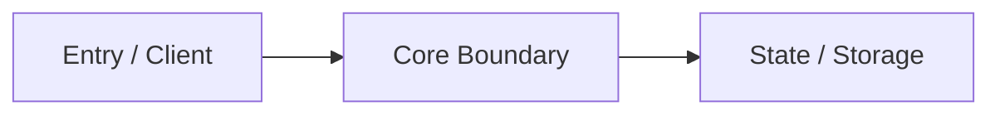

# Design Doc: <Project / Platform Name>

- **Slug:** `<slug>`
- **Date:** `<YYYY-MM-DD>`
- **Status:** Draft | Goldfish-Reviewed | Approved
- **Mode:** `greenfield` | `redesign`
- **Suite:** [Design Doc](./design.md) · [Technical Plan](./tech-plan.md) · [Lean-Runbook Spec](./spec.md)
- **Target Budget:** ≤1,400 words (~7 min read) *(complex ceiling: ≤3,600 words)*

## 1. Executive Summary
3–5 crisp sentences: what is changing, why the current state/prior plan fails, the core architectural shift, and the measurable outcome.

## 2. Problem, Constraints & Non-Goals
- **Problem:** `<2-3 bullet points of concrete pain/failure modes>`
- **Hard Constraints:** `<budget, latency/SLA, security, compatibility, team/ops limits>`
- **Explicit Non-Goals:**
  - `<what this design intentionally excludes so scope cannot creep>`

## 3. Business Requirements Registry
Canonical source of truth. Downstream docs (`tech-plan.md`, `spec.md`) **reference `BR-*` by ID** — never re-state prose.

| ID | Priority | Requirement (Observable Business Outcome) | Success Metric / Proof |
|---|---|---|---|
| `BR-1` | P0 | | |
| `BR-2` | P0 | | |
| `BR-3` | P1 | | |

## 4. Legacy / Input Risk Elimination Matrix *(Required in `redesign` mode; remove if `greenfield`)*
Audit of risks inherited from `<input plan / legacy platform>`. Every `RISK-*` must be **structurally eliminated** (not merely monitored) and verified in `tech-plan.md`.

| ID | Inherited Risk / Failure Mode | Root Cause in Old Plan / System | Structural Elimination in New Design |
|---|---|---|---|
| `RISK-1` | | | |
| `RISK-2` | | | |

## 5. Target Architecture
Keep to **one** crisp diagram + a responsibility table. Detailed schemas, wire contracts, and invariants belong in `tech-plan.md`.

| Component / Boundary | Single Responsibility | Owns State? | Satisfies |
|---|---|---|---|
| `<Component A>` | | Yes (`<store>`) / No | `BR-1`, `RISK-1` |
| `<Component B>` | | | `BR-2` |

## 6. Key Architectural Decisions (ADRs)
Numbered, binding decisions. Keep each row to 1–2 crisp lines.

| ID | Decision | Rationale / Tradeoff Accepted | Reversibility |
|---|---|---|---|
| `ADR-1` | | | Easy \| Moderate \| Hard |
| `ADR-2` | | | |

## 7. Rejected Alternatives (1 Line Each)
Prevent future sessions from re-litigating settled paths.

| Alternative | Why Rejected |
|---|---|
| `<Rejected approach / prior plan pattern>` | `<1-line concrete reason>` |
