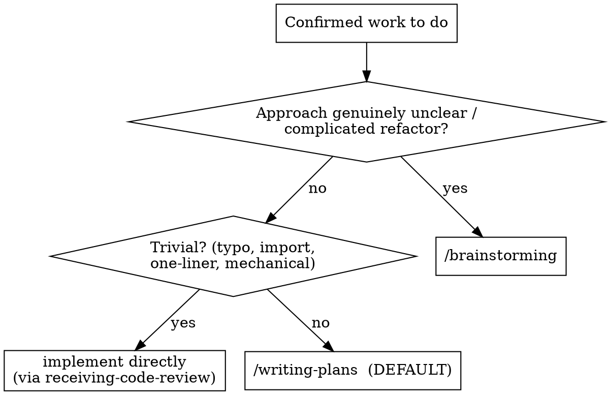

# Receiving a Deep Review

## Overview

A deep-review report is a set of **claims to verify**, not a task list to execute. Its
findings come from sub-agents that produce false positives (that's why each carries a
`disposition`). Reviews also go stale — a finding may already be fixed.

**Core principle:** Verify every finding against the current code, then route the
confirmed work through the normal planning flow. **Never implement-and-commit straight
from the report.**

**REQUIRED SUB-SKILL (or standalone discipline):** In Claude Code with `superpowers`,
use `superpowers:receiving-code-review` for evaluation discipline. Outside Claude Code
(or without `superpowers`), apply the same discipline directly: verify every finding
against live code before accepting it, push back with technical evidence on false
positives, and avoid performative agreement. This skill adds the deep-review artifact
handling around it.

## When to Use

- You're the implementing session and a prior session left a `docs/reviews/*.md` report.
- Someone says "act on the review", "implement the deep review", "address the findings".
- **Not** for review feedback handed to you inline or as raw PR comments — that's plain
  superpowers:receiving-code-review.

## Process

### 1. Locate & parse
Arg may be a path, a PR number, or nothing → default to the newest `docs/reviews/*.md`,
preferring one whose slug matches the current branch. Parse the verdict + each finding
(`F1…Fn`: severity, axis, `location`, what/why/fix, `disposition`, `resolution`).
Full blocks for non-attention findings live in the report's `## Appendix` — read them
there, not just the summary tables. Older reports have no `resolution` field: treat
every finding as `judgment`. If the file is missing, or the verdict is APPROVE with no
findings, say so and stop.

### 2. Verify each finding is REAL
Check each against the **current** code at its `location` — the problem may be stale
(already fixed) or a false positive. Default to verifying inline; for a large review
(>~8 findings) fan out one verify sub-agent per finding.
- `defensible` findings start **one strike down**: the review already rebutted them.
  Require positive evidence to override the rebuttal — don't re-litigate from scratch.
- Per-finding verdict: **CONFIRMED** (real, fix warranted) / **REFUTED** (stale, false
  positive, or rebuttal stands) / **NEEDS-JUDGMENT** (real, but the fix is a judgment
  call or conflicts with intent).

### 3. Triage & curate — split by resolution
Show the verified table (`F-id` · severity · `resolution` · verdict · one-liner), then
curate in two passes:
- **Judgment findings** (`resolution: judgment`, plus anything verified
  NEEDS-JUDGMENT): present individually — **the user decides each one**. Flag
  BLOCKER/HIGH as strongly recommended, but never auto-select by severity.
- **Mechanical findings** (`resolution: mechanical`, verified CONFIRMED): present as
  ONE batch with a single default-yes confirmation — `Fix all N? (y / veto IDs)`.
  Do NOT walk the user through them one by one; that per-finding load is exactly what
  this split removes. A vetoed ID is recorded as deferred, not re-argued.

#### How each judgment finding is written

The user is triaging, not reading code. Every judgment finding you present has these
five parts, in this order:

1. **Setup** — what the system was doing and who was involved, in domain words
   ("the worker processes queued webhook jobs in three retry tiers").
2. **What goes wrong** — the sequence, step by step, in the order it happens.
3. **What someone actually sees** — customer impact, operator impact, or explicitly
   "nothing visible; it's noise in the logs".
4. **How likely** — what has to coincide for it to happen.
5. **The choice** — the options, then your recommendation and the one reason for it.

Identifiers (function names, state names, status codes, `select_for_update`) come
*after* the plain sentence that explains them, as supporting detail — the plain sentence
carries the meaning on its own. The one-liners in the verified table and each line of the
mechanical batch follow the same terms.

The review file's own wording is written for a reviewer who just read the diff. Restating
it is what this recipe replaces.

**Worked example** — the same finding, review wording then triage wording:

> **Review:** The idempotent-success branch has a check-then-act race — a concurrent POST
> that loses the claim re-reads state as `order_dispatched` and answers 200 while the
> winner's downstream fulfillment call is still in flight.

> **Triage:** Two webhook deliveries can arrive for the same order. The first one to claim
> it calls the downstream fulfillment API; the second sees "already handled" and replies
> success. But it replies success while the first request is still mid-flight — so if that
> downstream call fails and the first handler rolls back, the webhook sender has already
> received a 200 and stops retrying. Worst case the order never dispatches until a
> reconciliation job catches it. Needs both deliveries inside the window of one downstream
> API call, *and* that call to fail.

### 4. Close the loop (part 1 — record)
Write the verdicts + the user's decisions back into the review file as a `## Reception`
section (per finding: confirmed / refuted / deferred + one-line reason). This is the
durable record.

### 5. Route the confirmed work — DEFAULT is /writing-plans
Do **not** implement-and-commit by default. Route by weight:

The two non-default routes must clear a bar; **if neither bar passes, /writing-plans.**
This puts the *changes themselves* through plan → review → executing-plans before code
lands. *(Outside Claude Code or without `superpowers`, substitute your harness's
equivalent: write an explicit implementation plan — e.g., `docs/plans/<slug>.md` or a
`lean-runbook` contract plan — and get user approval before coding; use your normal
design/brainstorm flow when the approach is unclear.)* A CONFIRMED `mechanical` batch
normally clears the trivial bar (each item is
small, self-contained, fix fully stated) — implement it directly under
receiving-code-review discipline; `judgment` work rarely does and defaults to
/writing-plans. Mixed set: knock out the trivial items directly, route the rest; bias
to the heavier route when unsure.

### 6. Close the loop (part 2 — after merge)
Once changes land: mark the acted findings done in the review file, and if deep-review
posted PR comments, reply on those threads (`gh api .../comments/{id}/replies`).

## Red Flags — STOP

- "The review says X, I'll just do X." → Verify X is real and current FIRST.
- "I'll implement these and commit." → No. Default route is /writing-plans.
- "While I'm here I'll also fix this unrelated thing." → Surface it for approval; don't
  fold scope expansion into the branch silently.
- "This finding is marked defensible but I'll fix it anyway." → The review argued against
  it; override only with positive evidence.
- Finishing without updating the review file. → Step 4 is not optional.

## Common Mistakes

| Mistake | Fix |
|---------|-----|
| Trusting findings without checking code | Verify each at its `location`; reviews go stale |
| Implementing + committing from the report | Route to /writing-plans (default) |
| Auto-acting on all BLOCKER/HIGH | User curates; severity informs, doesn't decide |
| Walking the user through mechanical findings one by one | One batch confirmation: `Fix all N? (y / veto IDs)` |
| Treating a stated fix as pre-approved judgment | `judgment` findings need the user's call even when a fix is written out |
| Presenting findings in the review's reviewer-facing wording | Rewrite each to the five-part plain-English recipe; the user is triaging, not reading the diff |
| Repeating the review's scenario without checking it | The review can be right that a bug exists and wrong about how it's reached — verify the sequence, not just the code |
| Silent scope creep | Surface non-finding fixes for approval |
| Review file never updated | Record verdicts in a `## Reception` section |
